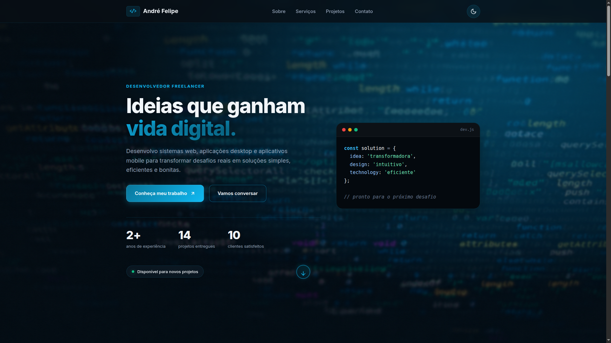
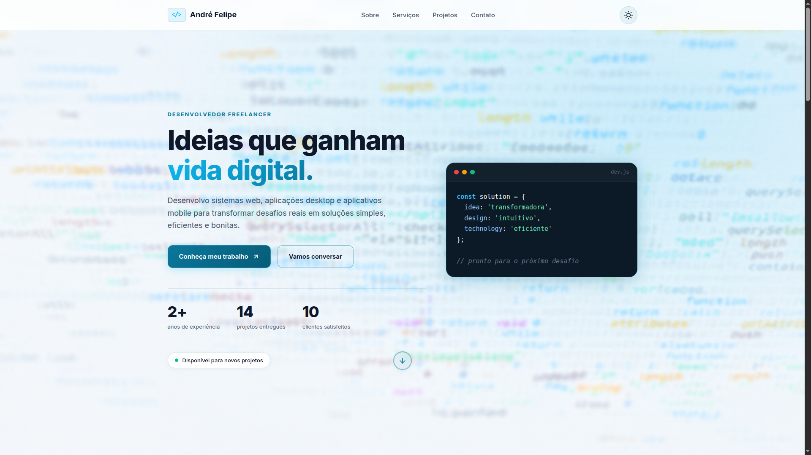
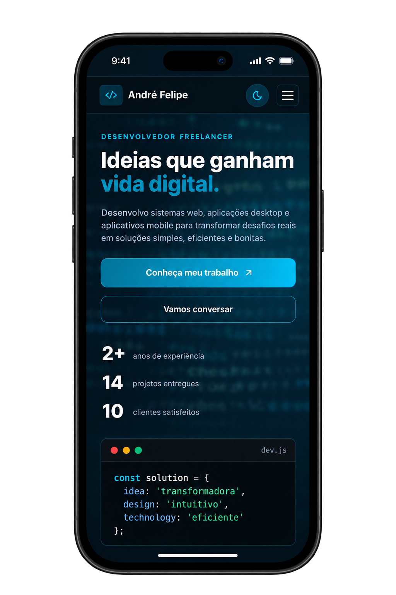

# Portfólio Front-End | André Felipe

Landing page responsiva desenvolvida como projeto acadêmico de portfólio profissional, utilizando **HTML5 semântico**, **CSS3 modular com metodologia BEM e variáveis nativas**, **JavaScript Vanilla** e práticas de **acessibilidade**.

> **Acesse o projeto online:** [https://andref03.github.io/Portfolio/](https://andref03.github.io/Portfolio/)

---

## Demonstração Visual

### Desktop - Modo Escuro

<div align="center">
  <a href="https://andref03.github.io/Portfolio/" target="_blank">
    
  </a>
</div>

<br>

### Desktop - Modo Claro

<div align="center">
  <a href="https://andref03.github.io/Portfolio/" target="_blank">
    
  </a>
</div>

<br>

### Versão Mobile

<div align="center">
  <a href="https://andref03.github.io/Portfolio/" target="_blank">
    
  </a>
</div>

---

## Funcionalidades

- **Alternância de Tema (Dark/Light):** Detecção automática da preferência do sistema e persistência da escolha com `localStorage`.
- **Layout Responsivo:** Adaptação completa para desktop, tablet e smartphones via Media Queries.
- **Navegação Acessível:** Menu mobile e atributos ARIA para leitores de tela.
- **Identidade Visual Própria:** Paleta em tons de azul e petróleo com bordas decorativas.

---

## Estrutura do Projeto

O CSS e o JavaScript são modulares para facilitar a manutenção e organização:

```text
Portfolio/
├── index.html          # Marcação semântica da página
├── css/
│   ├── variables.css   # Cores da paleta, tipografia e transições
│   ├── base.css        # Reset, tipografia global e utilitários
│   ├── layout.css      # Header fixo, Hero, seções e rodapé
│   ├── components.css  # Botões, cards, badges e mockups
│   └── responsive.css  # Breakpoints para celular e tablet
├── js/
│   ├── theme.js        # Lógica de alternância e salvamento de tema
│   └── main.js         # Menu mobile e interatividades
└── assets/
    ├── icons/          # Ícones vetoriais SVG
    └── images/         # Imagens de fundo, fotos e mockups
```

---

## Escolhas Técnicas

- **HTML5 Semântico:** Uso de tags estruturais (`<header>`, `<nav>`, `<main>`, `<section>`, `<article>`, `<footer>`).
- **Metodologia BEM:** Classes previsíveis sem conflito de especificidade.
- **Variáveis CSS Nativas:** Controle centralizado de temas diretamente no `:root` e `[data-theme="light"]`.
- **Vanilla JS:** Zero bibliotecas ou dependências pesadas, garantindo carregamento rápido e funcionamento offline.

---

## Acesso e Execução

### Projeto Publicado (GitHub Pages)

Você pode testar a aplicação em funcionamento diretamente pelo link:  
**[https://andref03.github.io/Portfolio/](https://andref03.github.io/Portfolio/)**

### Execução Local

1. Clone o repositório:

   ```bash
   git clone https://github.com/andref03/Portfolio.git
   cd Portfolio
   ```

2. Abra o arquivo `index.html` diretamente no navegador, ou inicie um servidor local:
   ```bash
   python3 -m http.server 3000
   # Acesse no navegador: http://localhost:3000
   ```

---

## Autor

**André Felipe**

- LinkedIn: [linkedin.com/in/andref-lopes](https://www.linkedin.com/in/andref-lopes/)
- GitHub: [@andref03](https://github.com/andref03)
- Instagram: [@andref_03](https://www.instagram.com/andref_03/)
